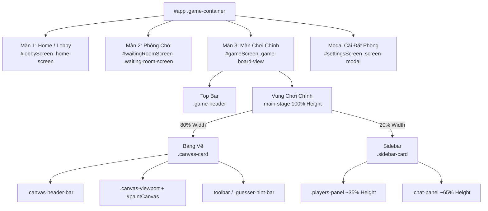

# 🎨 TÀI LIỆU THIẾT KẾ UI & LAYOUT FRONTEND (DOODLEPARTY)

> **Dự án:** DoodleParty – Vẽ Đi Chờ Chi (Scribble Web Realtime)  
> **Công nghệ:** HTML5, CSS3 (Design Tokens + Grid + Flexbox), Vanilla JS (ES Modules), Canvas 2D API, Vite  
> **Phong cách UI:** Gen Z Cyber-Pop / Modern Dark Mode / Neon Glow / Glassmorphism  

---

## 📌 1. TỔNG QUAN KIẾN TRÚC UI FRONTEND

Giao diện Frontend được thiết kế theo hướng **Single Page Application (SPA) không phụ thuộc framework cồng kềnh**, sử dụng Native HTML5 Canvas và CSS Tokens tối ưu để đạt độ mượt mà cao nhất (Zero-lag, 60fps).



---

## 🎨 2. HỆ THỐNG DESIGN TOKENS (`frontend/src/ui-tokens.css`)

Toàn bộ hệ thống UI kế thừa từ biến CSS tập trung tại [`frontend/src/ui-tokens.css`](file:///f:/project/frontend/src/ui-tokens.css):

### 2.1. Bảng Màu Nền & Brand Accents
| Tên Biến | Giá Trị Hex / HSL | Mục Đích Sử Dụng |
| :--- | :--- | :--- |
| `--color-bg-base` | `#0a0f1d` | Nền tối chủ đạo sâu thẳm |
| `--color-bg-card` | `#141d33` | Nền nổi cho các khối thẻ Card, Panel, Bảng vẽ |
| `--color-bg-card-subtle` | `#1c2744` | Nền toolbar, khung phụ |
| `--color-bg-surface` | `#243256` | Nền chip, hover, nút bấm phụ |
| `--color-brand-primary` | `#6366f1` | Tím Indigo chủ đạo |
| `--color-brand-glow` | `#818cf8` | Viền phát sáng ánh neon tím |
| `--color-brand-secondary` | `#ec4899` | Hồng Neon tạo điểm nhấn phá cách |
| `--color-brand-gradient` | `linear-gradient(135deg, #6366f1, #ec4899)` | Dải màu gradient logo, nút chính |

### 2.2. Trạng Thái & Bảng Màu Vẽ (Palette)
* **Trạng thái:**
  * Thắng / Đoán đúng: `--color-success` (`#10b981`)
  * Đếm ngược / Cảnh báo: `--color-warning` (`#facc15`)
  * Hết giờ / Nguy hiểm: `--color-danger` (`#ef4444`)
  * Từ khóa / Thông tin: `--color-info` (`#38bdf8`)
* **10 Màu Vẽ Chuẩn Cho Canvas:**
  `#1e1e24` (Đen chì), `#ef4444` (Đỏ), `#f97316` (Cam), `#eab308` (Vàng), `#22c55e` (Lục), `#06b6d4` (Cyan), `#3b82f6` (Lam), `#a855f7` (Tím), `#ec4899` (Hồng), `#ffffff` (Trắng).

---

## 🖥️ 3. CÁC MÀN HÌNH CHÍNH & FLOW ĐIỀU HƯỚNG

Ứng dụng chia làm 3 màn hình và 1 modal cài đặt:

1. **Màn 1: Trang Chủ / Tạo & Vào Phòng (`#lobbyScreen`)**:
   * Header: Logo, chọn Avatar dạng Popover Grid emoji, nhập nickname, ô nhập mã phòng nhanh và nút "Tạo phòng".
   * Body: Hero Section chọn chế độ chơi (Luân phiên, Đấu tốc độ 1v1, Tiếp sức).
2. **Màn 2: Màn Hình Phòng Chờ Toàn Diện (`#waitingRoomScreen`)**:
   * Thiết kế giao diện toàn màn hình (Full-screen Dedicated View), không dùng popup tù túng.
   * Cột trái: Mã phòng kèm nút copy nhanh, nút "Bắt đầu" (chỉ Host thấy), cảnh báo số người chơi.
   * Cột phải: Grid thẻ người chơi theo thời gian thực (hiển thị icon vương miện 👑 cho chủ phòng).
   * Top bar phòng chờ: Nút mở Cài đặt ⚙️ (chỉ Host) và nút Thoát phòng.
3. **Modal: Cài Đặt Phòng Chơi (`#settingsScreen`)**:
   * Tùy chỉnh chế độ chơi, thời gian vẽ mỗi lượt (30s - 120s hoặc tự nhập), số người chơi tối đa (slider 2 - 16).
   * **Auto-save:** Mọi thao tác lưu và đồng bộ tức thì qua WebSocket tới tất cả người trong phòng.
4. **Màn 3: Màn Chơi Chính (`#gameScreen`)**: Nơi diễn ra trận thi đấu vẽ và đoán chữ.

---

## 📐 4. CHI TIẾT BỐ CỤC MÀN CHƠI CHÍNH (`#gameScreen .game-board-view`)

Màn chơi được xây dựng theo tỷ lệ **80% (Bảng vẽ) - 20% (Sidebar Chat & Người chơi)** với **chiều cao 100% full viewport** (sau khi trừ Top bar).

### 4.1. Sơ Đồ Bố Cục Desktop / Tablet Ngang

```
┌────────────────────────────────────────────────────────────────────────────────────────────────────────┐
│ TOP BAR TÍCH HỢP (.game-header)                                                                        │
│ [Left: Logo | Mã phòng | 🟢 Ktor] [Center: ⏱️ 38s | Vòng 1/3 | Gợi ý ô từ nổi bật] [Right: 🔊 | Vai trò]│
├───────────────────────────────────────────────────────────────┬────────────────────────────────────────┤
│                                                               │ SIDEBAR (.sidebar-card)                │
│ BẢNG VẼ (.canvas-card) - 80% CHIỀU RỘNG, 100% CHIỀU CAO        │ 20% CHIỀU RỘNG, 100% CAO               │
│ (Được giải phóng 100% chiều cao cho khung vẽ)                 ├────────────────────────────────────────┤
│ ┌───────────────────────────────────────────────────────────┐ │ DANH SÁCH NGƯỜI CHƠI                   │
│ │                                                           │ │ (.players-panel) ~35%                  │
│ │                                                           │ │ • 🦊 Họa Sĩ (120 pts)                  │
│ │                  VÙNG VẼ CANVAS 2D                        │ │ • 🐱 Bạn (80 pts)                      │
│ │               (#paintCanvas trong #canvasViewport)        │ │ • 🐰 Thỏ Con (40 pts)                  │
│ │                 (100% Height, Co giãn tự động)            │ ├────────────────────────────────────────┤
│ │                                                           │ │ KHUNG CHAT ĐOÁN TỪ                     │
│ │                                                           │ │ (.chat-panel) ~65%                     │
│ │                                                           │ │ • Chat tin nhắn...                    │
│ ├───────────────────────────────────────────────────────────┤ │ • Thông báo đoán đúng                 │
│ │ Toolbar: [10 Màu] | [4 Cỡ cọ] | [🧹][🗑️] | [🎉 Biểu cảm]   │ ├────────────────────────────────────────┤
│ │ (Người đoán: hiển thị .guesser-hint-bar + [🎉 Biểu cảm])  │ │ [ Nhập đoán từ... ][Gửi]                │
│ └───────────────────────────────────────────────────────────┘ └────────────────────────────────────────┘
└────────────────────────────────────────────────────────────────────────────────────────────────────────┘
```

### 4.2. Nguyên Lý Triển Khai Kỹ Thuật (CSS Grid & Flexbox)

1. **Top Bar Tinh Gọn & Nổi Bật Từ Khóa ([`.game-header`](file:///f:/project/frontend/src/style.css#L59-L135))**:
   * Thiết kế 3 phân vùng cân đối:
     * **Cột trái (`.topbar-left`)**: Logo thương hiệu, chip mã phòng với nút sao chép link, và đèn tín hiệu kết nối WebSocket Ktor (`#wsStatus`).
     * **Cụm trung tâm (`.topbar-center`)**: Đồng hồ đếm ngược (`#timerVal`), thông tin vòng chơi (`#canvasRoundInfo`), và khu vực hiển thị từ khóa / gợi ý ô chữ (`#secretWord`) chiếm trọn tầm nhìn trung tâm với độ tương phản cao và hiệu ứng ánh sáng phát quang Neon cyan.
     * **Cột phải (`.topbar-right`)**: Nút bật/tắt âm thanh (`#soundToggleBtn`), và huy hiệu vai trò (`#roleBadge`: Họa sĩ / Người đoán).
   * **Cơ chế hiển thị từ khóa tối giản & chuẩn xác (`.word-group`, `.char-slot`, `.word-space`)**:
     * **Phía họa sĩ**: Nhãn được thu gọn tối giản thành **"Từ khóa:"** (thay vì câu dài trước đó). Từng chữ cái đặt trong ô `.char-slot.revealed` bo góc với hiệu ứng viền phát sáng nhẹ.
     * **Phía người đoán**: Nhãn hiển thị **"Từ có X chữ:"** (chỉ đếm tổng số ký tự chữ cái thực tế, không tính khoảng trắng).
     * **Khoảng trắng giữa các từ (`.word-space`)**: Là khoảng trống trắng thực sự (`background: transparent; width: 20px; gap: 0;`), kích thước thu nhỏ đúng bằng 1 ô ký tự, giúp các từ tách rời tự nhiên, cân đối và không bị quá rộng.
     * **Ô ký tự ẩn (`.char-slot.hidden-slot`)**: Sử dụng một đường gạch chân phát sáng duy nhất dưới đáy ô, không lồng ký tự `_` vào nội dung để loại bỏ hoàn toàn hiện tượng hiển thị thành 2 đường gạch (dấu `=`).
2. **Khung bao bọc màn chơi ([`.game-board-view`](file:///f:/project/frontend/src/style.css#L40-L50))**:
   * `height: 100%`, `width: 100%`, `display: flex; flex-direction: column;`
   * `gap: clamp(6px, 1vh, 10px)` – giữ khoảng cách cân đối, không làm tràn trang.
3. **Khu vực thi đấu ([`.main-stage`](file:///f:/project/frontend/src/style.css#L141-L153))**:
   * `display: grid; grid-template-columns: 4fr 1fr;`
   * Đảm bảo chính xác tỉ lệ **4 : 1 (tương đương 80% : 20%)** trên toàn bộ chiều rộng khả dụng sau khi trừ gap.
   * `flex: 1; height: 100%; min-height: 0; align-items: stretch;` – Bảng vẽ và Sidebar luôn có **chiều cao bằng nhau 100%**.
4. **Bảng vẽ & Khay Biểu Cảm Phía Dưới ([`.canvas-card`](file:///f:/project/frontend/src/style.css#L155-L170), [`.toolbar`](file:///f:/project/frontend/src/style.css#L444-L460), [`.reaction-popover-wrapper`](file:///f:/project/frontend/src/style.css#L470-L555))**:
   * Toàn bộ thanh header bên trong bảng vẽ đã được chuyển lên Topbar, giải phóng 100% chiều cao cho `#canvasViewport`.
   * **Nút thả icon biểu cảm tích hợp ở dưới thanh vẽ**:
     * Chỉ hiển thị duy nhất **1 nút icon** (`🎉` `#drawerReactTrigger` trong toolbar cho họa sĩ và `#guesserReactTrigger` trong thanh chỉ dẫn cho người đoán).
     * Khi người chơi bấm vào nút, khay biểu cảm `.reaction-popover-menu` sẽ tự động bung nở (popover sổ lên phía trên) với hiệu ứng làm mờ kính Glassmorphism, hiển thị danh mục icon phong phú: ❤️, 😂, 🔥, 👏, 🥳, ❓, 💩, 💯.
     * Bấm vào bất kỳ icon nào sẽ bắn hiệu ứng thả cảm xúc bay lên màn hình của mọi người trong phòng và tự động thu gọn khay lại.
     * Hỗ trợ bấm ra ngoài vùng popover để tự đóng nhanh chóng.
   * `width: 100%; height: 100%; min-width: 0; min-height: 0;`
   * Viewport vẽ ([`.canvas-viewport`](file:///f:/project/frontend/src/style.css#L198-L208)): `flex: 1; min-height: 0; position: relative;`
   * Canvas element ([`#paintCanvas`](file:///f:/project/frontend/src/style.css#L215-L223)): `position: absolute; inset: 0; width: 100%; height: 100%;`
5. **Sidebar ([`.sidebar-card`](file:///f:/project/frontend/src/style.css#L405-L420))**:
   * `width: 100%; height: 100%; min-width: 0; min-height: 0; max-width: none;`
   * Chứa 2 panel phân tầng:
     * **Danh sách người chơi ([`.players-panel`](file:///f:/project/frontend/src/style.css#L424-L430))**: `flex: 0 0 35%; max-height: 38%; min-height: 110px;` với danh sách cuộn mượt.
     * **Khung chat ([`.chat-panel`](file:///f:/project/frontend/src/style.css#L432-L437))**: `flex: 1; min-height: 0;` với ô nhập và nút gửi ghim đáy.

---

## 📱 5. THIẾT KẾ ĐÁP ỨNG (RESPONSIVE ADAPTIVE)

Hệ thống layout tự động thích ứng với mọi kích cỡ màn hình:

| Thiết Bị / Độ Rộng | Bố Cục (`.main-stage`) | Kích Thước Bảng Vẽ | Kích Thước Sidebar |
| :--- | :--- | :--- | :--- |
| **PC Siêu Rộng (> 1600px)** | Grid `4fr 1fr` (80% / 20%) | 100% Height, 80% Width | 100% Height, 20% Width |
| **PC Chuẩn (1281px - 1600px)** | Grid `4fr 1fr` (80% / 20%) | 100% Height, 80% Width | 100% Height, 20% Width |
| **Laptop / Tablet Ngang (769px - 1280px)** | Grid `4fr 1fr` (80% / 20%) | 100% Height, 80% Width | 100% Height, 20% Width |
| **Mobile / Màn Hình Dọc ($\le 768px$)** | Flex Column (Xếp chồng dọc) | Height cố định 380px | Min-height 350px (dưới bảng vẽ) |

### Tối ưu hiển thị cho cột 20% (Chống vỡ giao diện):
* `.player-meta`: Sử dụng `min-width: 0;` kết hợp `white-space: nowrap; overflow: hidden; text-overflow: ellipsis;` trên `.player-name` giúp tên dài tự động thu gọn bằng dấu `...` mà không làm xô lệch điểm số.
* `.chat-input-bar`: Input có `min-width: 0; flex: 1;`, nút Gửi có `flex-shrink: 0;` đảm bảo nút bấm không bị bóp méo trên màn hình thu nhỏ.

---

## ⚡ 6. CƠ CHẾ ĐỒNG BỘ VÀ HIỆU NĂNG CANVAS (`src/canvas.js`)

1. **Co Giãn Theo Thời Gian Thực (`ResizeObserver`)**:
   Canvas được gắn `ResizeObserver` theo dõi trực tiếp thẻ cha `#canvasViewport`. Khi cửa sổ thay đổi kích thước hoặc chuyển màn hình, hàm `handleResize()` tự động sao chép lại nét vẽ cũ sang canvas đệm, cập nhật kích thước mới và vẽ lại mà không làm mất hình ảnh.
2. **Hỗ Trợ Màn Hình Retina / High DPI**:
   Nhân đôi pixel buffer theo tỷ lệ `window.devicePixelRatio`, đảm bảo nét vẽ mượt mà, không bị răng cưa trên màn hình độ phân giải cao (MacBook Retina, 2K/4K).
3. **Phân Quyền Vai Trò (Drawer vs Spectator)**:
   * **Họa sĩ (`isDrawer = true`)**: Hiển thị đầy đủ thanh công cụ chọn màu, cỡ cọ, tẩy, xóa hết; con trỏ chuột dạng `crosshair`.
   * **Người đoán (`isDrawer = false`)**: Ẩn thanh công cụ, hiển thị banner nhắc nhở ([`.guesser-hint-bar`](file:///f:/project/frontend/src/style.css#L307-L322)), vô hiệu hóa thao tác vẽ trên canvas để chống vẽ bậy.
4. **Cơ Chế Chống Zoom Toàn Diện (Anti-Zoom View Protection)**:
   * **Desktop**: Chặn toàn bộ thao tác thu phóng ngoài ý muốn: `Ctrl + Lăn chuột` (Wheel), `Ctrl + '+'`, `Ctrl + '-'`, `Ctrl + '0'`, `Ctrl + '='`.
   * **Mobile / Safari Touchpad**: Chặn cử chỉ pinch-to-zoom đa điểm (`touchstart > 1`), chặn `gesturestart/gesturechange/gestureend` trên iOS Safari, và chặn double-tap phóng to nhanh.
   * **Viewport & CSS**: Cấu hình `<meta name="viewport" content="..., maximum-scale=1.0, user-scalable=no, shrink-to-fit=no">` kết hợp `touch-action: pan-x pan-y;` và `overscroll-behavior: none;` giúp cố định tỉ lệ 100% full-screen.

---

## 📋 7. BẢNG TRA CỨU FILE NGUỒN FRONTEND

| Tệp Tin | Vai Trò & Chức Năng |
| :--- | :--- |
| [`frontend/index.html`](file:///f:/project/frontend/index.html) | Cấu trúc HTML ngữ nghĩa của toàn bộ 3 màn hình và modal cài đặt |
| [`frontend/src/ui-tokens.css`](file:///f:/project/frontend/src/ui-tokens.css) | Toàn bộ biến Design Tokens: Màu sắc, Fonts, Spacing, Shadows, Radius |
| [`frontend/src/style.css`](file:///f:/project/frontend/src/style.css) | Stylesheet chi tiết cho tất cả component, layout 80/20 và responsive |
| [`frontend/src/canvas.js`](file:///f:/project/frontend/src/canvas.js) | Lớp `PaintCanvas` xử lý logic vẽ, tọa độ cảm ứng/chuột, DPR scaling và resize |
| [`frontend/src/main.js`](file:///f:/project/frontend/src/main.js) | Điều phối luồng ứng dụng, WebSocket client, xử lý chuyển màn hình và chat |
| [`frontend/src/audio.js`](file:///f:/project/frontend/src/audio.js) | Hệ thống âm thanh Web Audio API (pop, correct, tick, timeup) |
| [`frontend/src/effects.js`](file:///f:/project/frontend/src/effects.js) | Hiệu ứng pháo hoa Confetti và icon cảm xúc bay lơ lửng (Floating Reactions) |
